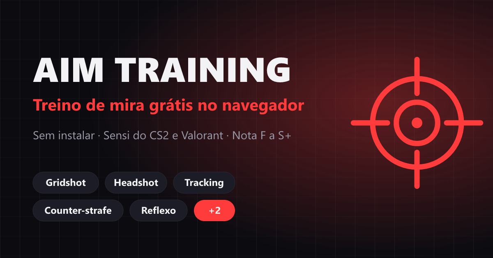

# Aim Training

Treino de mira grátis no navegador. Sessões curtas, nota de F a S+, sensi importada do seu jogo e recordes salvos no próprio dispositivo.

**Jogar:** https://treino-de-mira.vercel.app



## Modos

| Modo | Treina | Como funciona |
| --- | --- | --- |
| Gridshot | Velocidade | Três alvos numa grade 3×3. Acerte o máximo sem perder precisão. |
| Flick | Precisão | Um alvo pequeno por vez, em qualquer ponto do campo. |
| Headshot | Posicionamento da mira | Inimigos perto e longe com a cabeça na mesma linha. Tiro no corpo conta como erro. |
| Spidershot | Flick e volta | Alterna um alvo no centro e um espalhado. |
| Tracking | Acompanhar | O alvo faz ADAD e troca de direção sem aviso. Mantenha a mira em cima. |
| Counter-strafe | Controle AD | Dê peek na parede com A/D, pare com a tecla oposta e atire. Tiro andando espalha. |
| Reflexo | Reação | Clique quando a tela ficar verde. Média de 5 rodadas. |

Os modos com tempo têm sessões de 30s ou 60s, cada um com recorde e histórico próprios.

## Sensibilidade

Escolha o jogo e digite a sensi que você usa:

| Jogo | Graus por count | FOV horizontal |
| --- | --- | --- |
| Counter-Strike 2 | 0,022 × sensi | 106,26° |
| Valorant | 0,07 × sensi | 103° |
| Apex Legends | 0,022 × sensi | 106,26° |
| Overwatch 2 | 0,0066 × sensi | 103° |

O giro por count do mouse fica igual ao do jogo perto da mira, que é o que importa em flick curto e tracking. Com o DPI informado, a tela mostra os cm/360. Também dá para usar uma sensi personalizada (1 = cursor do sistema).

## Recursos

- Mira travada no centro como num FPS (Pointer Lock, com input bruto quando o navegador suporta).
- 8 estilos de mira, com cor, tamanho, espessura, espaço central e contorno.
- Música gerada em tempo real pelo jogo (Web Audio): sem copyright, pode usar em live.
- Nota de F a S+, comparação com o recorde e gráfico das últimas partidas.
- Instalável como app (PWA) e com imagem de compartilhamento.
- Atalhos: `Esc` pausa, `R` reinicia na pausa, `Espaço` joga de novo no resultado.

## Stack

Vite + TypeScript, sem framework. Canvas 2D com `requestAnimationFrame`, sons e música por Web Audio, persistência em `localStorage`. Testes com Vitest.

```
src/
  main.ts              telas e fluxo
  sensitivity.ts       conversão de sensi por jogo
  game/engine.ts       loop, câmera, pointer lock, pausa
  game/modes/          um arquivo por modo + catálogo
  game/renderer.ts     campo, alvos, parede, medidor
  game/crosshair.ts    estilos de mira
  ui/                  menu, resultado, configurações
  audio.ts music.ts    efeitos e música procedural
```

## Rodar local

```bash
npm install
npm run dev
```

`npm test` roda os testes. `npm run build` faz type-check e build de produção em `dist/`.

## Deploy

Vercel (`vercel.json`): build `npm run build`, saída `dist`. O endereço antigo `jota-lives.vercel.app` redireciona para o novo.

## Autor

João Pedro Santana · [portfólio](https://joaopedrotech.netlify.app) · [GitHub](https://github.com/jpsantana6699)
